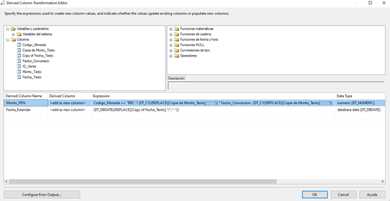
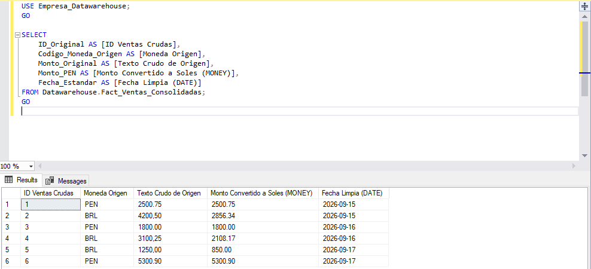

# Pipeline ETL para Consolidación Financiera Regional (Perú / Brasil)

## 📌 Descripción del Proyecto
Proyecto de práctica que simula un problema habitual en empresas multinacionales de LATAM: consolidar ventas de filiales que registran sus datos en monedas y formatos distintos.

Las filiales operativas registran sus ventas diarias en sus respectivas monedas locales (Soles PEN y Reales BRL), utilizando configuraciones regionales distintas para los decimales (puntos vs. comas) y estructuras de texto mixtas para las fechas.

Se diseñó un proceso ETL con SQL Server e Integration Services (SSIS) en Visual Studio que extrae los datos, los limpia, los convierte a una sola moneda (PEN) y los carga en una tabla de hechos de un Data Warehouse. Los datos utilizados son simulados.

---

## 🏗️ Arquitectura del Flujo de Datos (Data Flow)
El pipeline procesa los datos en memoria, en un solo Data Flow y sin etapas intermedias de scripting:

```text
  [ OLEDBS_Ventas_Crudas ] (Extracción de Operaciones.Ventas_Crudas, PE / BR)
                   │
                   ▼
  [ DC_Estandarizar_Tipos_Texto ] (Data Conversion: copia de columnas de texto con tipos compatibles)
                   │
                   ▼
  [ LK_Factor_Tipo_Cambio ] (Lookup por Codigo_Moneda en Dim_Tipo_Cambio)
                   │
                   ▼
  [ DER_Limpieza_Y_Conversion_Moneda ] (Derived Column: lógica condicional de conversión)
                   │
                   ▼
  [ OLEDBD_Fact_Ventas_Consolidadas ] (Carga en la tabla de hechos del Data Warehouse)
```

---

## 🗄️ Objetos de Datos

| Objeto | Rol | Columnas |
|---|---|---|
| `Operaciones.Ventas_Crudas` | Origen (transaccional) | `ID_Venta`, `Codigo_Moneda`, `Monto_Texto`, `Fecha_Texto` |
| `Datawarehouse.Dim_Tipo_Cambio` | Lookup (factor por moneda) | `Codigo_Moneda`, `Factor_Conversion` |
| `Datawarehouse.Fact_Ventas_Consolidadas` | Destino (tabla de hechos) | `ID_Fact_Venta` (int, identidad), `ID_Original` (int), `Codigo_Moneda_Origen` (varchar 3), `Monto_Original` (varchar 50), `Monto_PEN` (money), `Fecha_Estandar` (date) |

Bases de datos: `Empresa_Transaccional` (origen) y `Empresa_Datawarehouse` (destino).

---

## 🛠️ Reglas de Calidad Implementadas en la Columna Derivada

### 1. Unificación Monetaria (`Monto_PEN`)
Se utilizó una expresión condicional para limpiar la configuración regional brasileña (reemplazo de comas por puntos), castear la cadena a tipo dinero (`DT_CY`) y aplicar el factor de conversión solo cuando la venta corresponde a la filial extranjera (BRL). Las ventas en PEN no se multiplican:
```text
[Codigo_Moneda] == "BRL" ? (DT_CY)(REPLACE([Copia de Monto_Texto],",",".")) * [Factor_Conversion] : (DT_CY)(REPLACE([Copia de Monto_Texto],",","."))
```

### 2. Estandarización Cronológica (`Fecha_Estandar`)
Se corrigieron las barras regionales a guiones y se forzó el casteo al tipo de fecha nativo (`DT_DBDATE`, formato `YYYY-MM-DD`):
```text
(DT_DBDATE)(REPLACE([Copy of Fecha_Texto],"/","-"))
```

---

## 📊 Resultados Técnicos y Verificación en SQL Server
El paquete se ejecutó correctamente y cargó las 6 filas de prueba en la tabla de hechos. En el resultado, los montos de BRL aparecen convertidos a soles (por ejemplo, `4200,50` → `2856.34`) y los de PEN se mantienen iguales.

```sql
USE Empresa_Datawarehouse;
GO

SELECT
    ID_Original          AS [ID Ventas Crudas],
    Codigo_Moneda_Origen AS [Moneda Origen],
    Monto_Original       AS [Texto Crudo de Origen],
    Monto_PEN            AS [Monto Convertido a Soles (MONEY)],
    Fecha_Estandar       AS [Fecha Limpia (DATE)]
FROM Datawarehouse.Fact_Ventas_Consolidadas
ORDER BY ID_Original;
GO
```

---

## 🖼️ Evidencia de Ejecución

### 1. Flujo de datos (Data Flow)
Los cinco componentes terminaron en verde.


### 2. Ejecución del paquete (Control Flow)
El paquete `01_Carga_Ventas_Consolidadas.dtsx` se ejecutó completo, sin errores.


### 3. Lógica de limpieza y conversión (Derived Column)
Expresiones de `Monto_PEN` y `Fecha_Estandar` en el editor de SSIS.



### 4. Resultado final en el Data Warehouse
Datos convertidos a PEN y con fecha estándar en `Datawarehouse.Fact_Ventas_Consolidadas`.



---

## 🎯 Habilidades Demostradas
* **Modelamiento dimensional básico** (tabla de hechos y dimensión de tipo de cambio)
* **Calidad de datos:** limpieza y estandarización de formatos de monto y fecha
* **SQL Server Integration Services (SSIS):** Data Flow con Data Conversion, Lookup y Derived Column
* **SQL Server:** consultas de verificación sobre el Data Warehouse
* **Lógica de negocio financiera:** conversión multimoneda a una moneda base

---

## 🚀 Posibles Mejoras
* Usar un tipo de cambio histórico por fecha en lugar de un factor fijo por moneda.
* Redirigir las filas con error (monto o fecha inválidos) a una tabla de errores para su revisión.
* Programar la carga con SQL Server Agent.
